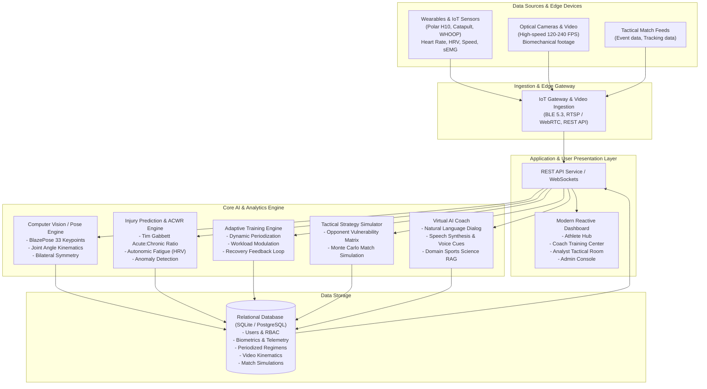
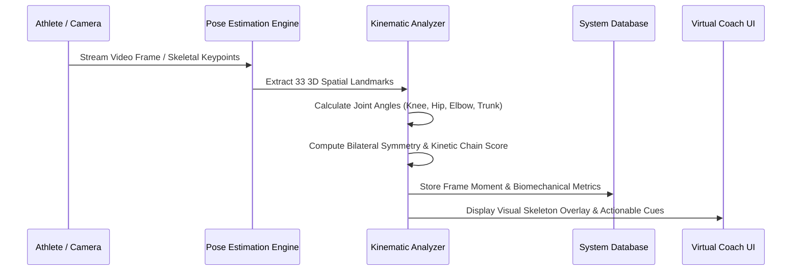
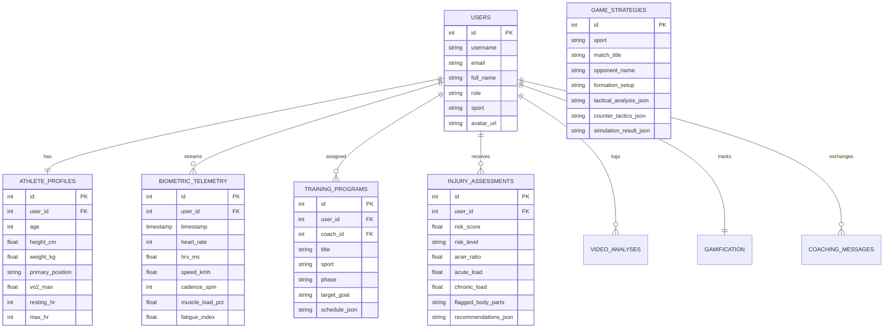

# Athelytix AI — System Architecture & Design Specification

This document details the end-to-end system architecture, data flows, AI/ML pipelines, database schema, and deployment topology for the AI-Powered Sports Coaching Platform.

---

## 1. High-Level System Architecture

---

## 2. Data Flow Pipeline

### 2.1 Wearable IoT Telemetry Pipeline
1. **Sensor Ingestion**: Wearable sensors stream ECG/PPG, inertial measurement unit (IMU), and GPS data at 50 Hz.
2. **Filtering & Preprocessing**: Noise removal, Kalman filtering for GPS speed and acceleration peaks.
3. **Feature Extraction**: Computes rolling 7-day acute load and 28-day chronic load, RMSSD heart rate variability, and mechanical sEMG load.
4. **Real-time Alerting**: If ACWR exceeds 1.35 or HRV drops > 15%, alerts coach and automatically calibrates next training session.

### 2.2 Computer Vision Biomechanics Pipeline

---

## 3. Database Schema (Entity-Relationship)

---

## 4. Non-Functional Architecture & Scaling

1. **Sub-100ms Latency**: Real-time sensor stream ingestion uses asynchronous processing and in-memory caches for rolling telemetry.
2. **Scalability**: Stateless microservices architecture for AI inference. The model inference nodes can scale horizontally behind load balancers.
3. **Data Privacy & Compliance**: Health metrics and biometric data conform to HIPAA / GDPR requirements; data is encrypted in transit (TLS 1.3) and at rest (AES-256).
4. **Role-Based Access Control (RBAC)**:
   - **Athlete**: Access to own profile, telemetry, adaptive workouts, coach chat, and badges.
   - **Coach / Trainer**: Full access to all team athletes, ability to adjust workout prescriptions, review squad injury risk dashboard, run tactical scenarios.
   - **Sports Analyst**: In-depth biomechanics analysis, kinematic angles, telemetry data exports, and tactical simulation modeling.
   - **Admin**: Full system management, user role assignments, audit logs.
